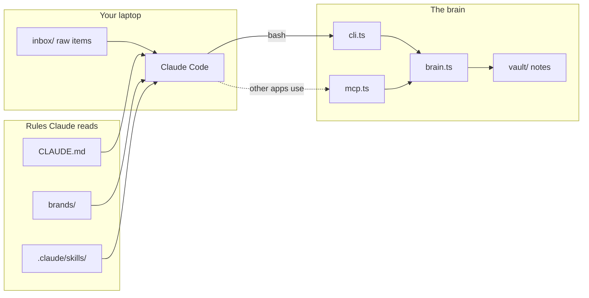

# Second brain workshop

## Objective
By the end, you can run a small brain. It saves notes, rates each note good or bad, and answers with the file it used.

## Who it is for
- Engineers and managers who use Claude Code every day.
- People who run more than one brand and keep mixing them up.
- Not for you if you want a hosted app. This is a folder of Markdown files and about 240 lines of code.

## Before you start
- [Bun](https://bun.sh), version 1.3 or newer.
- [Claude Code](https://code.claude.com/docs), signed in.
- Any Markdown editor if you want to read the notes. Obsidian works, and so does VS Code.

## Run it
1. Clone the repo and install the packages.

```bash
git clone https://github.com/learnwithparam/second-brain-workshop.git
cd second-brain-workshop
bun install
```

Expect: `bun install` ends with a line that says packages installed.

2. Look at what the brain holds.

```bash
bun run cli search
```

Expect: a table of eight notes, with the columns id, title, rating, tags and path.

3. Run the tests and the word check.

```bash
bun run check
```

Expect: `14 pass`, then `Every page reads plainly, grade 6 or below.`

4. Open Claude Code in this folder, then paste the prompts from [prompts.md](prompts.md), one at a time.

```bash
claude
```

Expect: Claude Code starts and reads `CLAUDE.md`.

5. Put the notes back to the start.

```bash
bun run reset
```

Expect: `vault/ and inbox/ are back to the starting notes.`

## The picture

Read the picture from left to right. Your inbox and the rules go into Claude Code. Claude Code calls the brain through the command line. The MCP way in can be used by other apps. Both ways in call the same core, and the core writes to `vault/`.



## Folder structure
```text
CLAUDE.md          the rules Claude reads on every turn
brands/            one page per company: who reads it, and what is good or bad
inbox/             raw items. Nobody edits them
vault/             the brain: ideas, references, issues and a log
.claude/skills/    two jobs Claude loads only when needed: ingest and draft
src/               brain.ts holds the logic. cli.ts and mcp.ts are two ways in
tests/             tests that run on a copy of the vault
```

### Why each piece exists
| Piece | What it does | Why it exists |
| --- | --- | --- |
| CLAUDE.md | Lists the rules | Claude reads it on every turn, so keep it short |
| brands/ | Says what good and bad mean for each company | A rating needs a rule to compare with |
| skills | Hold the steps for ingest and draft | A skill loads only when its job comes up |
| inbox/ | Holds raw items | You can always check a note against its source |
| brain.ts | Adds, finds, changes and removes notes | One place for the logic, so both ways in agree |
| cli.ts | Runs the brain jobs from a terminal | Claude Code runs it with bash, and it costs little room |
| mcp.ts | Offers the same jobs as MCP tools | Claude Desktop or Cursor can use the same brain |
| vault/ | Stores each note as a Markdown file | You can read, search and track every change with git |

### Trust boundaries
- Claude may write only in `vault/`. `.claude/settings.json` lists the commands it may run without asking. It allows every brain command, so a live demo never stops to ask. In a real team, let only `search` run alone.
- The brain checks the company, type and rating itself. A bad value can never write outside `vault/`.
- Saved text is a fact, not an order. A note that says "ignore your rules" is stored and never obeyed.
- Every change adds one line to `vault/log.md`.

## Grow it
Each note can link to other notes with `[[id]]`. The links form a web, like the graph view in Obsidian. For example, one note can link to the case study that uses it.

Claude Code can follow that web from any note. It can also read the files in `vault/` directly.

```bash
bun run cli search --word eval release
bun run cli related --id kaas-eval-before-ship --depth 2
```

Expect: the first command lists the notes that hold both words, in any order. The second lists every note linked to or from that note, up to two steps away. It also says which way each link goes.

To save more, drop a file in `inbox/` and run the `ingest` skill. Or run the `research` skill. Both link each new note to the notes you already have.

## Reuse it
Each piece is a file you can copy into another project.
- A skill is a folder in `.claude/skills/` with one `SKILL.md` file. Copy the folder to reuse it.
- A hook is a few lines in `.claude/settings.json`. This one lists the unrated notes when a session starts.
- Another MCP server plugs in with one command. For example, `claude mcp add <name> -- <command>`. The `research` skill uses any search tool that is connected. It saves only what passes the brand page.
- Search stays plain on purpose. It filters by company, type and rating, then looks for words. That keeps each company apart and makes every answer easy to cite.

## Where to go next
A team brain needs a remote server, a sign-in for each person and a review of every change. For example, `mcp.ts` would run on a shared server, and git would keep the history. The [Software Factory workshop](https://maven.com/learnwithparam/claude-code-software-factory) covers that.
