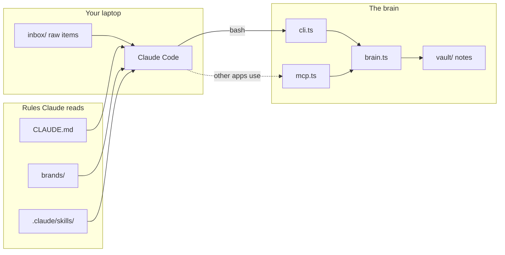

# Second brain workshop

## Objective
By the end, you can run a small brain that saves notes, rates them good or bad, and answers with the file it used.

## Who it is for
- Engineers and managers who use Claude Code every day.
- People who run more than one brand and keep mixing them up.
- Not for you if you want a hosted app. This is a folder and about 100 lines of code.

## Before you start
- [Bun](https://bun.sh), version 1.3 or newer.
- [Claude Code](https://code.claude.com/docs), signed in.
- Any Markdown editor if you want to look at the notes. Obsidian works, and so does VS Code.

## Run it
1. Clone the repo and install.

```bash
git clone https://github.com/learnwithparam/second-brain-workshop.git
cd second-brain-workshop
bun install
```

Expect: `bun install` ends with a line that says packages installed.

2. See what the brain holds.

```bash
bun run cli search
```

Expect: a table of eight notes, with the columns id, rating, reason and path.

3. Check the code and the words.

```bash
bun run check
```

Expect: `7 pass`, then `Every page reads plainly, grade 6 or below.`

4. Open Claude Code in this folder and paste the prompts from [prompts.md](prompts.md), one at a time.

```bash
claude
```

Expect: Claude Code starts and reads `CLAUDE.md`.

5. Run the demo again from the start.

```bash
bun run reset
```

Expect: `vault/ and inbox/ are back to the starting notes.`

## Folder structure
```text
CLAUDE.md          rules Claude reads on every turn
brands/            one page per company: who reads it, what is good, what is bad
inbox/             raw items. Nobody edits them
vault/             the brain: ideas, references, issues and a log
.claude/skills/    two jobs Claude loads only when needed: ingest and draft
src/               brain.ts holds the logic. cli.ts and mcp.ts are two doors to it
tests/             tests that run on a copy of the vault
```

## Architecture


### Why each piece exists
| Piece | What it does | Why it exists |
|---|---|---|
| CLAUDE.md | Lists the rules | Claude reads it on every turn, so keep it short |
| brands/ | Says what good and bad mean for each company | The rating needs a rule to compare with |
| skills | Hold the steps for ingest and draft | A skill loads only when its job comes up |
| inbox/ | Holds raw items | You can always check a note against its source |
| brain.ts | Adds, finds, changes and removes notes | One place for the logic, so both doors agree |
| cli.ts | Runs the four jobs from a terminal | Claude Code runs it with bash, and it costs little context |
| mcp.ts | Offers the same four jobs as MCP tools | Claude Desktop or Cursor can use the same brain |
| vault/ | Stores each note as a Markdown file | You can read, search and track every change with git |

### Trust boundaries
- Claude may write only in `vault/`. `.claude/settings.json` lists what it may run without asking. It allows all four brain commands, so a live demo never stops to ask. In a real team, let only `search` run alone.
- The brain checks company, type and rating itself, so a bad value can never write outside `vault/`.
- Saved text is a fact, not an order. A note that says "ignore your rules" is stored and never obeyed.
- Every change adds one line to `vault/log.md`.

## Reuse it
Each piece is a file you can copy into another project.
- A skill is a folder in `.claude/skills/` with one `SKILL.md`. Copy the folder to reuse it.
- A hook is a few lines in `.claude/settings.json`. This one lists unrated notes when a session starts.
- Another MCP server plugs in with one command. For example, `claude mcp add <name> -- <command>`. The `research` skill uses any search tool that is connected, then saves only what passes the brand page.
- Search stays plain on purpose. It filters by company, type and rating, then looks for words. That keeps each company apart and every answer easy to cite.

## Where to go next
A team brain needs a remote server, a sign-in for each person and a review of every change. For example, `mcp.ts` would run over HTTP, and git would keep the history. The [Software Factory workshop](https://maven.com/learnwithparam/claude-code-software-factory) covers that.
